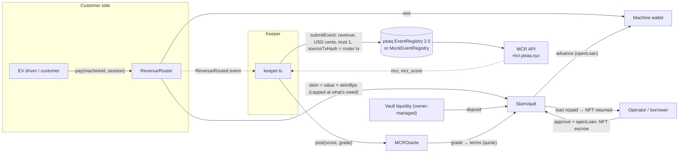
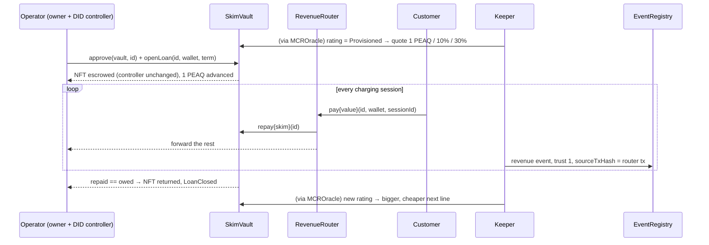
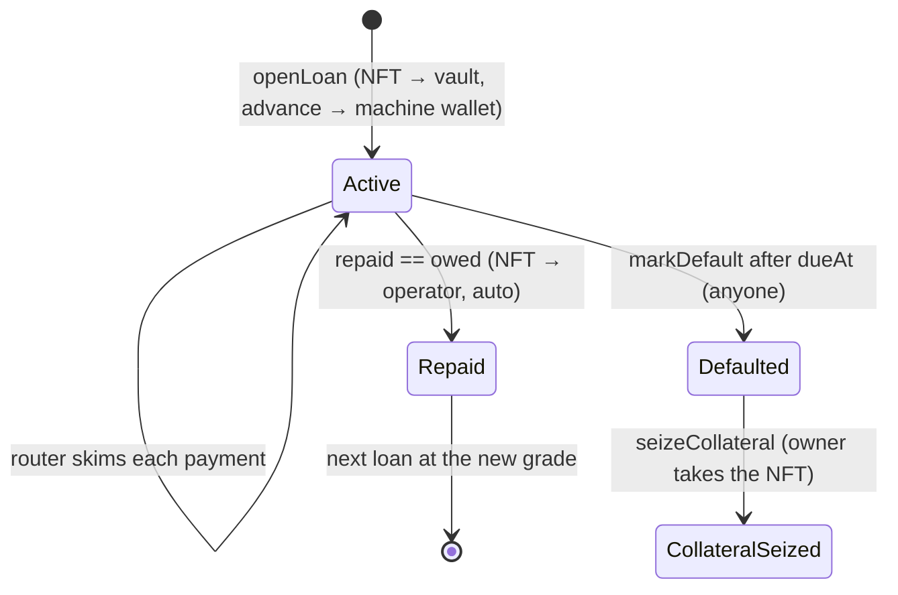
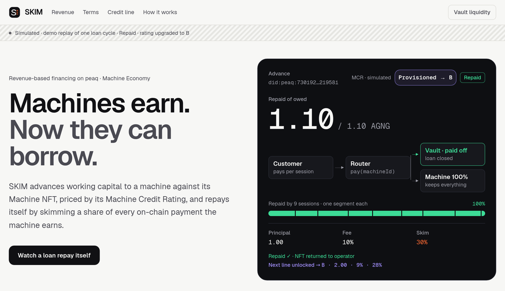

# SKIM: revenue-based credit for machines on peaq

> **Machines earn. Now they can borrow.**
> SKIM gives a working machine (here, an EV charger) an advance against its future revenue. As collateral, the machine
> hands its **Machine NFT** (its on-chain identity token on peaq) to the lending contract. A share of every customer
> payment is skimmed to repay the loan. When the loan is paid off, the NFT goes back to the machine's owner automatically.

*peaq "Advance the Machine Economy" track.*


<sub>**Live, not a mock-up:** the app reading peaq **agung testnet** (block 11138478) after the machine's second loan: 0.2 AGNG
at 9% fee / 28% skim, repaid in 8 routed payments, Machine NFT back with the operator, next line 0.5 AGNG at 7% / 22%.
The rating (B → BBB) is **simulated**, because agung has no MCR. Every transaction: [Proof](#-proof).</sub>


<sub>**The whole mechanism in 35 seconds** (demo replay, **simulated**: a scripted example machine with amounts 10× the agung run, not chain data). The NFT is escrowed, an advance is paid, every customer session sends 30% to the vault (one bar segment each), the loan closes at 100%, the NFT goes back to the operator and the rating moves **Provisioned → B**, which unlocks a bigger, cheaper next loan. The same loop ran for real on peaq agung testnet, twice (still above).</sub>

---

## ⏱️ Judge in 60 seconds

**What.** A lending protocol where the borrower is a *machine*. An EV charger (simulated) puts up its peaq Machine NFT
as collateral, receives an advance, and repays it automatically from a cut of every charging payment. It has run
end to end on **peaq agung testnet** with a machine ID it actually activated there, **twice**: after repaying the
first loan, the same machine got a bigger, cheaper second loan and repaid that too.

**Why machines.** Machines on peaq earn money on their own, but nobody lends to them: banks don't underwrite a device,
and DeFi lending wants over-collateralised tokens a machine doesn't hold. A machine's real asset is its **future
revenue** plus its **on-chain identity and history**. SKIM turns those two things into credit.

**Five terms used below.**

| Term | Meaning |
|---|---|
| **Machine NFT** | The token peaq mints when a machine is registered (Economics 2.0 `MachineRegistry`). Whoever holds it *owns* the machine's on-chain identity. SKIM uses it as loan collateral. |
| **DID / peaqID** | The machine's decentralised identifier, `did:peaq:<machineId>`. Owning the NFT and *controlling* the DID are separate roles, so the operator keeps running the machine while the NFT is escrowed. |
| **MCR** | Machine Credit Rating: peaq's credit score for a machine (grades Provisioned, B … AAA), computed from its revenue history. SKIM prices each loan from it. |
| **Trust-1 revenue event** | A revenue record in peaq's EventRegistry that cites a checkable on-chain transaction (trust level 1), as opposed to a self-reported number (trust 0). |
| **Keeper** | SKIM's off-chain bot: it watches router payments, files the revenue events and posts the rating on-chain. |

*agung* is peaq's public testnet (token AGNG); *subscan* is its block explorer. *Economics 2.0* is peaq's current
machine stack (activation, Machine NFT, EventRegistry 2.0). *Skim* = the fixed % of each payment that goes to the
lender until the loan is repaid.

**The flywheel, on-chain (agung testnet).**

| Loan #1 | → | Loan #2 | → | Unlocked next |
|---|---|---|---|---|
| **Provisioned** · 0.10 AGNG · 10% fee · 30% skim · ✅ [repaid, NFT back](https://agung-testnet.subscan.io/tx/0xb8fa6774b9388ae69a672739bc91c182fa68686da6dae011c5b3fc8a8b672995) | | **B** · 0.20 AGNG · 9% · 28% · separate customer wallet · ✅ [repaid, NFT back](https://agung-testnet.subscan.io/tx/0xf5f259c15a7ff6950c27475fc25cf66bc47a4a5793978b544eeec5cd77b1be46) | | **BBB** · 0.50 AGNG · 7% · 22% (not drawn) |

Ratings on agung are **simulated** (no MCR there); the loans, escrow, repayments and NFT returns are real testnet transactions.

**The loop, in one line.**
`MCR rating → loan terms → NFT escrowed, advance paid → each payment skims to the vault → keeper logs a trust-1 revenue event citing that payment → loan repaid, NFT returned → rating improves → bigger, cheaper next loan`

**What is real and what is simulated** (full table in [Status](#-what-is-real-what-is-simulated)):

| | Status |
|---|---|
| **Real machine ID on peaq agung testnet**: Economics 2.0 `activateMachine`, `did:peaq:7626…6194` | ✅ [Activation tx](https://agung-testnet.subscan.io/tx/0x753718fee2bc5275e46138f094a34036e30897f501ffb433f905cb60e99c4ea8) |
| **Full loan cycle on agung** with that machine's real Machine NFT: escrow → 8 routed payments → auto-repaid → NFT back → next line B | ✅ [openLoan](https://agung-testnet.subscan.io/tx/0x3e8bc2539edd50c3ed55b5d967a77e913df07f8cfc7c555454af67f8f82309aa) · [final payment + NFT return](https://agung-testnet.subscan.io/tx/0xb8fa6774b9388ae69a672739bc91c182fa68686da6dae011c5b3fc8a8b672995) |
| **Second, bigger and cheaper loan on agung** (0.2 AGNG @ 9% / 28% vs 0.1 @ 10% / 30%), paid by a separate customer wallet → repaid → NFT back → rating up to BBB | ✅ [openLoan #2](https://agung-testnet.subscan.io/tx/0x35ccdad22846286067b810c7ff8cdc30029f1c5a569142256032fd1c7bea9692) · [final payment + NFT return](https://agung-testnet.subscan.io/tx/0xf5f259c15a7ff6950c27475fc25cf66bc47a4a5793978b544eeec5cd77b1be46) |
| Contracts (vault, router, oracle): escrow, skim, auto-close, NFT return, default | ✅ Real code, 42/42 Foundry tests pass |
| Escrow of a **real peaq mainnet Machine NFT**, controller kept, trust-1 EventRegistry 2.0 event while escrowed | ✅ Proven on a **local fork of peaq mainnet** (nothing broadcast) |
| The EV charger and its customers | 🧪 Simulated (a script that pays the router with real testnet AGNG) |
| Revenue events + credit rating on agung | 🧪 Simulated: agung has no MCR and no EventRegistry 2.0, so events go to our `MockEventRegistry` and the rating is derived; both flagged `simulated = true`. Mainnet path uses the live MCR API + EventRegistry 2.0 |
| peaq mainnet deployment | ⏳ Not yet. Scripts ready; needs funded mainnet keys |

**Proof:** [agung run, every tx on subscan](docs/proof/agung.md) · [mainnet-fork transcript](#2-a-real-peaq-mainnet-machine-nft-escrowed-and-returned-mainnet-fork) · [42/42 test output](docs/proof/forge-test.txt) ([tests](contracts/test/Skim.t.sol)) · [live MCR API](docs/proof/mcr-api.txt) + [SDK on mainnet](docs/proof/sdk-preview.txt) (read-only) · in the app: the **Proof** row under *How it works*

---

## Why this matters for the Machine Economy

**Machines earn, but they can't borrow.** An EV charger, a compute node or a robot taxi earns money every day, yet it
has no way to fund a second charger out of that income. Revenue-based financing is how small businesses solve this;
SKIM makes the *machine* the borrower and lets the chain enforce the repayment.

**The numbers behind it** (each from a page we opened; no estimates of our own):
- 📈 **Supply of borrowers.** peaq reports **3.3 million machine identities, 200 million+ transactions and 60+ applications** on its network ([peaq, *Introducing Economics 2.0*, 30 Jul 2026](https://www.peaq.xyz/blog/introducing-peaq-economics-2-0-upgraded-to-set-machines-free)).
- 🕳️ **The gap.** peaq's financing rails today are Initial Machine Offerings for medium-to-large projects and structured debt facilities for large-scale deployment ([peaq Machine Financing](https://www.peaq.xyz/machine-financing)). Economics 2.0 lists **"rating-backed financing"** as a Pro-tier peaqOS function ([same Economics 2.0 post](https://www.peaq.xyz/blog/introducing-peaq-economics-2-0-upgraded-to-set-machines-free)). SKIM is a working prototype of that: one machine, one small line, repaid automatically from its own revenue.
- 🔌 **What a line would buy.** One public DC fast-charging connector costs about **$38,000–$90,000** in hardware plus **$20,000–$60,000** to install ([US DOE Alternative Fuels Data Center](https://afdc.energy.gov/fuels/electricity-infrastructure-development)). SKIM's terms table below is demo-sized (1–20 PEAQ, scaled 1/10 on agung); a production table would be set by the vault owner at that scale.

- 🧮 **Worked example (illustrative, from SKIM's own settings, not a forecast).** With the mainnet run settings in *Run it* (`TERMS_SCALE=150/1`), a new Provisioned machine gets **150 PEAQ** at 10% (owes 165) and 30% skim. Sessions of 240 PEAQ (≈ $10 at $0.043, the smallest revenue event the MCR counts) skim 72 each, so the line is repaid on the **3rd session**, and every one of those payments is MCR-countable history toward grade B (300 PEAQ, 9%, 28%).

More context (charging build-out, robots-as-a-service, DePIN capex), all sourced: [`docs/submission/IMPACT.md`](docs/submission/IMPACT.md).

SKIM uses peaq primitives as the mechanism itself, not as decoration:

| Problem | SKIM's answer | peaq primitive |
|---|---|---|
| What secures the loan? | The machine's **Machine NFT** is escrowed in `SkimVault`. On default the lender keeps it, and with it a machine that has an on-chain history. | Economics 2.0 **MachineRegistry** ERC-721 (`machineId == tokenId`) |
| Does escrow stop the machine working? | **No.** Moving a 2.0 Machine NFT moves ownership but *keeps the DID controller*. The operator still runs, renews and updates the machine, and keeps reporting its revenue. | Owner / controller split in **MachineRegistry** |
| Is the revenue real? | Every payment passes through `RevenueRouter`. The keeper turns each one into a **trust-level-1 revenue event** whose `sourceTxHash` is the router tx. Lenders count only revenue they watched pass through their own contract, not self-reported (trust 0) numbers. | **EventRegistry 2.0**, trust levels |
| How are terms priced? | Terms (principal, fee, skim %) come from the machine's **Machine Credit Rating**. | **MCR API** (`mcr.peaq.xyz`) |
| Who is the machine? | Every loan, event and rating is keyed to the machine's peaqID `did:peaq:<machineId>`. | **peaqID / DID** via Economics 2.0 activation |

**Who is on each side.** The *borrower* is a machine operator with a device that already earns on-chain (an EV
charger, a compute or connectivity node, a delivery robot) and wants capital for a second one. The *lender* supplies
native-token liquidity to the vault and earns the flat fee on each advance (on agung: 0.01 AGNG on a 0.1 AGNG loan).
In this build the vault's liquidity is owner-managed (no LP shares yet; see *Honest limitations* below).

**The loop closes on itself.** Rating → terms → repayment → trust-1 revenue events → better rating → better terms.
A brand-new **Provisioned** machine gets a small starter line. As it repays through the router, its revenue history
grows, it graduates to rated grades, and the next advance is bigger and cheaper.

**"Why wouldn't the machine just bypass the router?"** Because only routed revenue becomes trust-1 revenue events, and
those are what lift the machine's rating and unlock its next, larger line. Skipping the router means no credit
history, and the NFT (the machine's identity and history) stays in the vault until the loan is repaid or defaults.

```
Provisioned  1 PEAQ  10% fee  30% skim    ← starter line
B            2 PEAQ   9%      28%
BB           3 PEAQ   8%      25%
BBB          5 PEAQ   7%      22%
A            8 PEAQ   6%      20%
AA          12 PEAQ   5%      18%
AAA         20 PEAQ   4%      15%         (owner can rescale the table, e.g. TERMS_SCALE=1/10)
```

---

## 🧭 How it works

### Money flow


### One loan, step by step


### Loan states


---

## 🔎 Proof

Everything below is captured in [`docs/proof/`](docs/proof/): the agung write-up with every transaction of both loans (30 + 24 = 54, all status 1)
([`agung.md`](docs/proof/agung.md), raw logs in [`raw/`](docs/proof/raw/)), the mainnet-fork escrow check
([`mainnet-fork-escrow.txt`](docs/proof/mainnet-fork-escrow.txt)) and the test run
([`forge-test.txt`](docs/proof/forge-test.txt)), plus a short security review
([`security-review.md`](docs/proof/security-review.md)). Index of every proof file: [`docs/proof/README.md`](docs/proof/README.md). Older fork and local transcripts: [`agent/logs/`](agent/logs/).

### 1. A real machine borrows and repays on peaq agung testnet
Loan #1 ran on 2026-10-12 (≈22:18–22:22 IST); 30/30 transactions succeeded. One testnet wallet played every role
(operator, keeper, customer), so its payments loop back to the same address. Loan #2 (below) fixes that with a
separate customer wallet.
Contracts:
vault [`0xA97b…3D20`](https://agung-testnet.subscan.io/account/0xA97b3C4F7cf5468dB2507C5769ad973e02F33D20) ·
router [`0xeD42…9237`](https://agung-testnet.subscan.io/account/0xeD420FD5Ea0df60d2f873F13e34B4F5edbB99237) ·
oracle [`0x90DD…B793`](https://agung-testnet.subscan.io/account/0x90DD1c0C498243425dE0B93B6c7aa79bde15B793) ·
peaq MachineRegistry [`0x538d…b377`](https://agung-testnet.subscan.io/account/0x538da35489B1F0035799a8351E67835ae4ABb377) (real, not a mock).
Terms table scaled 1/10 to fit a testnet budget.

| Step | What happened | Tx |
|---|---|---|
| 1. Identity | peaqOS SDK `activateMachine` (Entry tier, 0.4 AGNG bond) mints the Machine NFT and `did:peaq:76267944…366194` | [`0x7537…4ea8`](https://agung-testnet.subscan.io/tx/0x753718fee2bc5275e46138f094a34036e30897f501ffb433f905cb60e99c4ea8) |
| 2. Rating | Keeper posts **Provisioned** (SIMULATED) → starter quote 0.1 AGNG, 10% fee, 30% skim | [`0xb11c…f99c`](https://agung-testnet.subscan.io/tx/0xb11c0ac3b9825836316f47513f7a1e1b1d9549f2061b3afe6c72fc697eabf99c) |
| 3. Escrow + advance | `openLoan`: the real Machine NFT moves into SkimVault, 0.1 AGNG lands in the machine wallet, owes 0.11 | [`0x3e8b…09aa`](https://agung-testnet.subscan.io/tx/0x3e8bc2539edd50c3ed55b5d967a77e913df07f8cfc7c555454af67f8f82309aa) |
| 4. Revenue | A customer pays 0.05 AGNG per charging session through the router: 0.015 skimmed to the vault, 0.035 to the machine | [session 1 `0xec6c…2261`](https://agung-testnet.subscan.io/tx/0xec6c4a448a81f0b07070b944ddd9abcb96ad06a32d2f674e71ea225f00f42261) |
| 5. Evidence | Keeper writes a trust-1 revenue event citing that router tx (MockEventRegistry, SIMULATED) | [`0x967d…4d00`](https://agung-testnet.subscan.io/tx/0x967da562b02d97b2e08024cd1c977d92a4b980a3aaacd16c6f05b0613c974d00) |
| 6. Payoff | Session 8 skims only the last 0.005 owed (capped), the loan closes and the NFT goes back to the operator in the same tx | [`0xb8fa…2995`](https://agung-testnet.subscan.io/tx/0xb8fa6774b9388ae69a672739bc91c182fa68686da6dae011c5b3fc8a8b672995) |
| 7. Flywheel | Rating re-posted as **B** (SIMULATED) → next line 0.2 AGNG, 9% fee, 28% skim | [`0xffb5…dc42`](https://agung-testnet.subscan.io/tx/0xffb58a97e734650a36c50d2e3c9483ba6353df576cd98ae88b678f718843dc42) |

State read back from agung afterwards (`cast call`, read-only): `ownerOf(machineId)` = operator `0x285a…066e`,
`controllerOf` = operator (never changed), `isActive` = false, `quote` = 0.2 AGNG / 900 bps / 2800 bps / grade 1 (B),
`getRating` = score 46, grade B, `simulated = true`. The vault ends with 0.51 AGNG: the 0.5 seed plus the 0.01 fee the
lender earned.

**Loan #2: the flywheel, on-chain** (≈22:39–22:45 IST, 24/24 txs succeeded, same contracts). Now rated B, the same
machine borrows **0.2 AGNG at 9% fee / 28% skim** (loan #1: 0.1 at 10% / 30%). A **separate customer wallet**
[`0x0c9A…E39d`](https://agung-testnet.subscan.io/account/0x0c9Aa6ea0e037F33225A3d1110790867F841E39d) pays 8 sessions of
0.1 AGNG, so subscan shows customer → router → vault (skim) + machine wallet (rest) as distinct parties.

| Step | What happened | Tx |
|---|---|---|
| Escrow + advance | `openLoan` at grade B: NFT into SkimVault again, 0.2 AGNG advanced, owes 0.218 | [`0x35cc…9692`](https://agung-testnet.subscan.io/tx/0x35ccdad22846286067b810c7ff8cdc30029f1c5a569142256032fd1c7bea9692) |
| Revenue | Customer `0x0c9A…` pays 0.1 AGNG through the router: 0.028 to the vault, 0.072 to the machine | [session 1 `0xd654…6b4e`](https://agung-testnet.subscan.io/tx/0xd654a2df0e7400ba577e5f351747ce07856e6ebbbd2843d7f5561a11692e6b4e) |
| Payoff | Session 8 skims the last 0.022, the loan closes and the NFT returns in the same tx | [`0xf5f2…be46`](https://agung-testnet.subscan.io/tx/0xf5f259c15a7ff6950c27475fc25cf66bc47a4a5793978b544eeec5cd77b1be46) |
| Flywheel | Keeper re-rates B 46 → BB 54 → **BBB 62** (SIMULATED) → next line **0.5 AGNG, 7% fee, 22% skim** (not drawn: capped at two loans) | [`0xfcae…b592`](https://agung-testnet.subscan.io/tx/0xfcaeb601758ad64fac3ad02eb0311dc3a66cdf4a17af979ecf1690e40515b592) |

Read back afterwards (block 11138301): NFT owner = operator, loan inactive, `totalRepaid` = 0.328 AGNG (0.11 + 0.218),
rating BBB 62 `simulated = true`, `quote` = 0.5 AGNG / 700 / 2200 bps, 16 revenue events each citing a distinct router
tx, vault 0.528 AGNG (seed + both fees). Every tx: [`docs/proof/agung.md`](docs/proof/agung.md) (Loan #2 section).

**Why the revenue events show 0 US cents.** peaq revenue events carry USD *cents*. A 0.05–0.1 AGNG testnet session is
worth under one cent (0.1 AGNG ≈ $0.0043), so the `value` field is 0. The router events carry the real AGNG amounts,
and since loan #2 the keeper also writes the native amount and micro-USD into each event's metadata. Example, loan #2
revenue event #8 ([`0x7c6d…3028`](https://agung-testnet.subscan.io/tx/0x7c6d2d7c60b9e919a4d1d774ec4b70bb35aade09bad978f49f4cb1fb594e3028),
metadata as stored on chain, abridged): `{"app":"skim","routerTx":"0xf5f259c1…be46","payer":"0x0c9Aa6…E39d","amountNative":"0.1","nativeSymbol":"AGNG","usdMicro":4300,"skimmedWei":"22000000000000000",…}`.

### 2. A real peaq mainnet Machine NFT, escrowed and returned (mainnet fork)
A local copy ("fork") of peaq mainnet's current state, run with anvil, with our contracts deployed on top. Nothing is
sent to the real network. The NFT is an already-activated Economics 2.0 machine in the live MachineRegistry
`0x64b9…5536`. Script: [`contracts/script/fork-escrow-check.sh`](contracts/script/fork-escrow-check.sh).
Transcripts: [`agent/logs/mainnet-fork-proof.txt`](agent/logs/mainnet-fork-proof.txt) (fork block ~11954840: escrow,
controller and EventRegistry checks, excerpt below) and a re-run of the escrow part at fork block 11957700,
[`docs/proof/mainnet-fork-escrow.txt`](docs/proof/mainnet-fork-escrow.txt) (2026-10-12 22:51 IST, PASS; reproduce with `bash scripts/setup.sh --fork`).

```text
machine 7256157558…630283 owner 0x8725C29f4216ec368Ac920A3097DCB916Aad068f
after openLoan: NFT owner = 0xDc64…F6C9 (SkimVault)
machine wallet balance = 0.01                       ← the advance arrived
loan status: closed                                 ← one router payment repaid it
after payoff: NFT owner = 0x8725C29f4216ec368Ac920A3097DCB916Aad068f
PASS: real Machine NFT escrowed and returned
controller during loan: 0x8725…068f (unchanged)     ← the operator keeps control
EventRegistry 2.0 0xA1e7…Ad1e getEventCount 0 -> submitEvent(trust 1) from controller while escrowed
  -> getEventCount 1; getEventAt returns sourceTxHash
```

What this proves: SkimVault works with the **real** MachineRegistry, escrow does **not** take the machine away from
its operator, and the machine can keep filing **trust-1 revenue events to the live EventRegistry 2.0** while its NFT
is collateral.

### 3. The contracts: 42/42 tests
```bash
cd contracts && forge test
# Suite result: ok. 42 passed; 0 failed; 0 skipped      (full output: docs/proof/forge-test.txt)
```
Covers: open loan, skim math (+fuzz), partial/excess repay, auto-close returns the NFT, default after due date,
seize, forwarding when there is no loan, reentrancy, access control, mock registry validation, stray-NFT rejection, and active-loan terms that owner/keeper changes cannot touch.

**Rating can't be pumped with fake events.** The keeper only counts trust-1 events whose cited tx is a real
`RevenueRouted` payment through the router. Regression test: 23 events in the registry, 20 of them spoofed;
the keeper counts 3 and rates accordingly ([`docs/proof/rating-integrity-test.txt`](docs/proof/rating-integrity-test.txt),
script `agent/scripts/test-rating-integrity.sh`).

### 4. The whole loop on a local chain (no funds needed)
`npm run local:e2e` (see below) deploys everything, mints a mock machine, runs a loan to payoff, re-rates the machine
and opens a second, larger loan driven by the standalone keeper and EV-charger simulator. Excerpt from
[`agent/logs/local-e2e.log`](agent/logs/local-e2e.log) (anvil's native test token prints as "ETH"):

```text
demo      session #8: 0.5000 -> skim 0.0500 | machine 0.4500 | repaid 1.1000/1.1000   ← last skim capped at what's owed
keeper    revenue event (SIMULATED registry) trust=1 cites router tx 0xc603894e…
demo      NFT owner is now 0x3C44…93BC (operator) -> RETURNED ✔
oracle    posted B (score 46) SIMULATED
demo      new terms for B: principal 2.0, fee 9%, skim 28%                             ← bigger line, cheaper
borrower  LOAN OPENED: NFT escrowed, 2.0 advanced; owes 2.18, skim 28%
```

### 5. peaq SDK and MCR API, read-only (mainnet)
`previewMachineActivation` (peaqOS SDK 0.11.2) on **peaq mainnet** returns an Entry-tier bond of **≈0.47 PEAQ**
(0.4703 at capture; priced in USD, so it moves with the token), and the SDK's machine ID matches our local
`keccak256(abi.encode(machineType, credentialSubject))`. The keeper's trust-1 event shape passes the SDK validator.
Transcript: [`docs/proof/sdk-preview.txt`](docs/proof/sdk-preview.txt) (throwaway key, nothing signed).
The live **MCR API** answers for the same real mainnet machine used in the fork check:
`{"mcr":"Provisioned","mcr_score":0,"bond_status":"bonded","revenue_event_count":0,…}`
([`docs/proof/mcr-api.txt`](docs/proof/mcr-api.txt)). A machine with no history is Provisioned, which is why SKIM
has a starter line. Re-run: `cd agent && NETWORK=mainnet npx tsx scripts/sdk-smoke.ts` (sends nothing).

---

## 🧪 What is real, what is simulated

| Piece | How SKIM uses it | Status in this build |
|---|---|---|
| **SkimVault / RevenueRouter / MCROracle** | The lending mechanism | ✅ Implemented, 42 tests. Not audited. |
| **Machine NFT (MachineRegistry ERC-721)** | The loan collateral, escrowed in SkimVault | ✅ **Live on agung**: the activated machine's real NFT was escrowed and returned, twice (two loans). ✅ Also verified on a mainnet fork. Local runs use `MockMachineNFT`. |
| **Owner/controller split** | Escrow keeps the operator in control | ✅ `controllerOf` unchanged on agung and on the mainnet fork while `ownerOf` = SkimVault. |
| **EventRegistry 2.0** (`0xA1e7…Ad1e`), trust level 1 | Trust-1 revenue events citing the router tx | ✅ **Verified on a mainnet fork** (trust-1 event from the controller while escrowed; `getEventAt` returns `sourceTxHash`). Mainnet keeper uses SDK `submitEvent`. 🧪 Local/agung use `MockEventRegistry` (labelled SIMULATED). |
| **Economics 2.0 activation** (`activateMachine`, Entry tier) | Gives the machine its `did:peaq:<id>`, Machine NFT and bond | ✅ **Activated on agung** (0.4 AGNG bond). ⏳ Not yet on mainnet (read-only preview there: ≈0.47 PEAQ bond, [transcript](docs/proof/sdk-preview.txt)). |
| **MCR API** `GET mcr.peaq.xyz/mcr/did:peaq:<id>` | Rating → terms | ✅ Live call verified (returns `mcr`, `mcr_score`; [transcript](docs/proof/mcr-api.txt)). 🧪 agung/local have no MCR, so ratings there are simulated and flagged `simulated = true` on-chain and in the UI. |
| **EV charger + customers** | Generates revenue | 🧪 Simulated (`simulator.ts` pays `router.pay` every N seconds). |
| **Web app** | Shows the loop | Tries the agung deployment first (`deployments/agung.json`, public RPC). While it connects, or if the RPC is unreachable, the mode bar says so and the labelled **Simulated** demo replay plays. `?demo` forces the replay. Demo hashes get a neutral "demo hash" chip, never a "verified" tick. |
| **Machine Explorer** `machines.peaq.xyz/machine/<id>` | Linked from the app | ⏳ Mainnet explorer; populates after a mainnet activation. |
| Tokenize / Machine Markets | Not used (Tokenize is "Coming Soon"). SKIM is the debt side. | n/a |

---

## ▶️ Run it in 2 commands

All commands run from the repo root (the `skim/` folder).

**Prereqs:** Node ≥ 22 and `curl`. Nothing else: the setup script installs the pinned toolchain.

**0. One-time setup (pinned, sends no transactions, reads no keys):**
```bash
bash scripts/setup.sh          # Foundry 1.8.5 + OpenZeppelin v5.1.0 + forge-std v1.17.0 → forge build → forge test (expects 42 passed)
bash scripts/setup.sh --all    # …plus the peaq mainnet-fork escrow check (local anvil fork, nothing broadcast) and npm ci for agent/ and web/
```
These are the exact versions the transcripts in [`docs/proof/`](docs/proof/) were produced with. `contracts/lib/` is not
committed, so a fresh clone needs this step; OpenZeppelin must stay 5.1.0 (5.2+ needs Cancun, peaq targets paris).
Manual equivalent: `cd contracts && forge install --no-git OpenZeppelin/openzeppelin-contracts@v5.1.0 foundry-rs/forge-std@v1.17.0 && forge test`.

**Just look (Node only, one command):** the app tries the real agung deployment (`deployments/agung.json`) and falls back to the labelled replay if the public RPC doesn't answer.
```bash
cd web && npm install && npm run dev      # http://localhost:3000  (add ?demo for the labelled replay)
```

**Run the whole loop yourself (2 commands, local chain, no funds):** after step 0,
```bash
cd agent && npm install && npm run local:e2e   # 1. contracts + keeper + EV-charger simulator on anvil (starts anvil if needed)
cd ../web && npm install && npm run dev        # 2. then open http://localhost:3000/?network=local
```

<details>
<summary><b>Step by step, agung testnet, peaq mainnet</b></summary>

### Local, step by step
```bash
anvil --block-time 1 &
cd agent
NETWORK=local npm run deploy
NETWORK=local npm run activate
NETWORK=local npm run demo                # rating → loan → sessions → NFT back → better rating
NETWORK=local npm run keeper &            # standalone keeper
NETWORK=local SESSION_VALUE=0.5 SESSION_INTERVAL=3 npm run simulator
```
Local uses the public anvil dev keys. It writes `deployments/local.json`; ABIs are in `deployments/abis.json`.

### agung testnet (simulated rating + events)
```bash
cp .env.example .env    # NETWORK=agung, PRIVATE_KEY=0x… (funded with AGNG), SEED_LIQUIDITY=2, PEAQ_USD=0.043
# Option A (spec default): mock Machine NFT
NETWORK=agung npm run deploy && NETWORK=agung npm run activate
# Option B (recommended rehearsal for mainnet): real Economics 2.0 activation on agung (bond 0.4 AGNG)
NETWORK=agung ACTIVATE_MODE=sdk npm run activate && NETWORK=agung npm run deploy
NETWORK=agung npm run demo        # or: keeper + simulator in two terminals
```
Explorer: https://agung-testnet.subscan.io. Ratings and events are labelled SIMULATED, because agung has no MCR and no
2.0 EventRegistry.

### peaq mainnet (live MCR + EventRegistry 2.0)
```bash
# .env: NETWORK=mainnet, OPERATOR_PRIVATE_KEY, DEPLOYER_PRIVATE_KEY, KEEPER_PRIVATE_KEY, CUSTOMER_PRIVATE_KEY
#       MACHINE_SERIAL=<unique>, PEAQ_USD=<today>
NETWORK=mainnet ACTIVATE_DRY_RUN=1 npm run activate   # preview the bond, sends nothing
NETWORK=mainnet npm run activate                      # Entry tier activation → deployments/mainnet.machine.json
NETWORK=mainnet TERMS_SCALE=150/1 SEED_LIQUIDITY=160 npm run deploy
NETWORK=mainnet npm run keeper &
NETWORK=mainnet npm run open-loan
NETWORK=mainnet SESSION_VALUE=240 SESSION_INTERVAL=30 STOP_WHEN_REPAID=1 npm run simulator
```
The MCR only counts revenue events worth **≥ $10** (1,000 USD cents). At about $0.043/PEAQ that is roughly 235 PEAQ
per session. With `TERMS_SCALE=150/1` the starter line is 150 PEAQ (owes 165), and 240-PEAQ sessions skim 72 each,
so the loan repays in 3 sessions. If the customer and operator are the same key, session money comes straight back,
so it only needs to be held once. A cheaper alternative is the spec table with small sessions: the loop still works,
but the MCR won't count those events.

</details>

---

## 🧱 What's in the box

### Contracts (`contracts/`, Foundry, Solidity 0.8.24, OpenZeppelin 5.1)

| Contract | What it does |
|---|---|
| `MCROracle` | Keeper-posted `Rating {score, grade, updatedAt, simulated}`. `grade` 0=Provisioned/NR … 6=AAA. |
| `SkimVault` | Liquidity (`deposit`), the grade→terms table, `quote`, `openLoan` (escrows the NFT, pays the advance), `repay` (anyone; caps at owed, refunds excess), auto-close + NFT return, `markDefault` after `dueAt`, `seizeCollateral` after default. |
| `RevenueRouter` | `pay(machineId, machineWallet, sessionId)`: skims to `vault.repay` while a loan is active (always to the *loan's* wallet), otherwise forwards everything. Emits `RevenueRouted`. Reentrancy-guarded. |
| `MockMachineNFT` | Open-mint ERC-721 stand-in for MachineRegistry (local/testnet). |
| `MockEventRegistry` | EventRegistry-shaped sink for networks without Economics 2.0 events. |

### Agent (`agent/`, Node 22, TypeScript, viem, `@peaqos/peaq-os-sdk` 0.11.2)

| Script | What it does |
|---|---|
| `scripts/deploy.ts` | Deploys everything, seeds liquidity, writes `deployments/<network>.json` (addresses + ABIs). |
| `scripts/activate.ts` | `ACTIVATE_MODE=sdk`: peaqOS **`activateMachine`** (Economics 2.0, Entry tier). `mock`: mints on MockMachineNFT. |
| `src/keeper.ts` | Loop 1: `RevenueRouted` → revenue event (type 0, USD cents, trust 1, `sourceTxHash` = router tx). Mainnet uses SDK `submitEvent`; testnet uses MockEventRegistry. Loop 2: MCR API (or simulated score) → `oracle.post`. |
| `src/simulator.ts` | EV charger. A customer pays `router.pay` every `SESSION_INTERVAL` seconds. |
| `src/demo.ts` | One-shot scripted demo of the whole loop. |
| `scripts/open-loan.ts`, `scripts/status.ts` | Operator helpers. |

### Web (`web/`, Next.js 15 static export)
Reads `deployments/<network>.json` (copied into `public/` by `npm run sync`). One screen: the loan instrument
(repaid / owed, the customer → router → vault | machine split, one payoff segment per session), the revenue feed with
keeper events inline, the terms staircase by grade, and how it works. *How it works* ends with a **Proof** row that is the
same in every mode (live or replay): subscan links for the real agung run (machine activation, NFT escrow + advance,
routed payments, repayment + NFT return, SkimVault, RevenueRouter), the mainnet-fork result and the test count. It
reads a static file, [`web/data/agung-proof.json`](web/data/agung-proof.json).


<sub>End state of the demo replay (simulated): repaid 100%, NFT back with the operator, rating Provisioned → B.</sub>

---

## ⚠️ Honest limitations

- **The oracle trusts the keeper.** `MCROracle` is fed by one keeper key. On mainnet it relays the public MCR (anyone
  can check it against `mcr.peaq.xyz`), but the contract can't verify that itself.
- **Revenue events are keeper-submitted.** Trust 1 means "cites a checkable on-chain tx". The MCR scores the
  declared trust level; it does not check that the router tx is real. Anyone can audit the link with `getEventAt`
  → `sourceTxHash` → router `RevenueRouted`.
- **The router is opt-in.** Revenue that bypasses `RevenueRouter` isn't skimmed. The backstops are the escrowed NFT,
  the due date / default path, and the fact that unrouted revenue builds no credit history.
- **No lender product yet.** Liquidity is owner-managed: there are no LP shares, and the owner can
  `withdrawLiquidity`. The app's vault-liquidity button demonstrates adding liquidity; it is not an investment product.
- **No borrower-side slippage bounds on `openLoan` yet** (security review F2, medium, open). Once a loan is open its
  terms are frozen, but between `approve` and `openLoan` the owner or keeper could worsen the quote. Fix designed
  (`minPrincipal / maxFeeBps / maxSkimBps` arguments), not shipped because it changes the ABI and needs a redeploy.
- **Single-asset, flat fee.** Native token only, a flat fee on principal, no interest accrual. A hackathon MVP, not
  audited.
- **A machine wallet that reverts on receive would block routed payments** for that machine (the router forwards
  with a plain call). Operators control their wallet, so this hurts only themselves; production would fall back to
  a pull-payment balance.
- **The demo machine would probably stay "Provisioned" during judging on mainnet.** The MCR needs history (daily
  revenue ≥ $10 across days) and caches responses for an hour. That is why the starter line exists, and why the
  rating → terms upgrade is shown in SIMULATED mode.
- **agung has no MCR and no 2.0 EventRegistry.** Testnet runs use a SIMULATED rating (derived from the count of
  trust-1 events) and `MockEventRegistry`, flagged on-chain (`Rating.simulated`) and in the UI.
- **Default.** `markDefault` is permissionless after `dueAt`, and the owner can then `seizeCollateral`. There is no
  auction. Economics 2.0 grace/runoff rules (a terminated machine's NFT is burned) mean a lender has to act within
  the subscription window.
- **Testnet, not mainnet.** The public run is on agung, where revenue events and ratings are simulated. The mainnet
  pieces (EventRegistry 2.0, real Machine NFT escrow) are proven on a fork; the live MCR has only been read.

## 🗺️ Roadmap

1. **Next:** mainnet: activate a machine, run the same loop with the live MCR and real EventRegistry 2.0 events
   (sessions ≥ $10 so the MCR counts them), and let the rating move from real history. Ship borrower-side bounds on
   `openLoan` (`minPrincipal / maxFeeBps / maxSkimBps`, security review F2) in that same deployment.
2. **Trust-minimised inputs:** signed MCR attestations or several keepers instead of one keeper key, so the oracle
   no longer trusts a single hot key.
3. **A real lender side:** LP shares with pro-rata repayments, per-grade pools, interest that accrues with time.
4. **Default market:** auction a defaulted machine's NFT (and its revenue history) instead of owner seizure.
5. **Composability:** let Machine Markets / Tokenize price a machine's revenue stream as the senior claim, with SKIM
   as the debt tranche.

---

## Repo map
```
skim/
  scripts/      setup.sh: pinned one-time setup (Foundry 1.8.5, OZ 5.1.0, forge-std 1.17.0) → 42 tests (+ --fork)
  contracts/    Foundry: src/, test/Skim.t.sol (42 tests), script/fork-escrow-check.sh
  agent/        deploy / activate / keeper / simulator / demo (+ .env.example), logs/ (proof transcripts)
  deployments/  <network>.json (addresses, machineId, ABIs), abis.json (all ABIs incl. PeaqEventRegistry)
  web/          Next.js app (reads deployments/<network>.json)
  docs/         proof/ (captured runs), submission/ (video script, form text), img/, PUBLISH-CHECKLIST.md
  SPEC.md       the shared build spec
  CHANGES.md    deviations from SPEC.md
```
Video script: [`docs/submission/VIDEO_SCRIPT.md`](docs/submission/VIDEO_SCRIPT.md)

