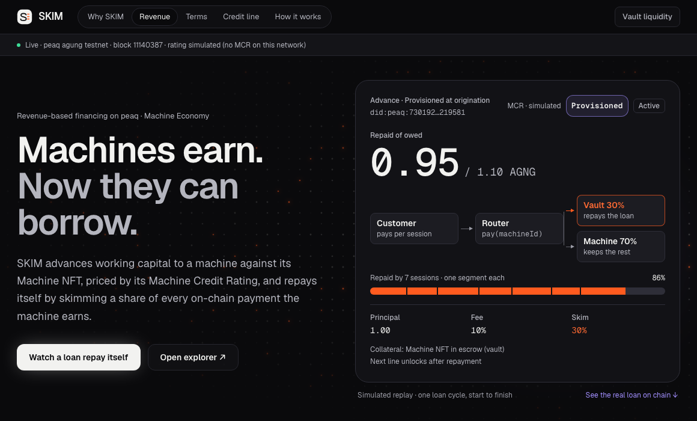
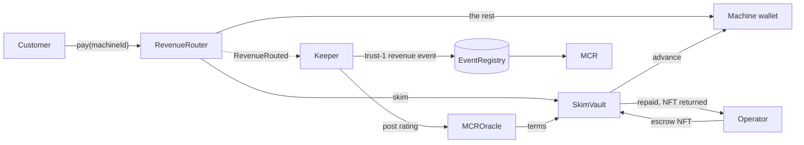
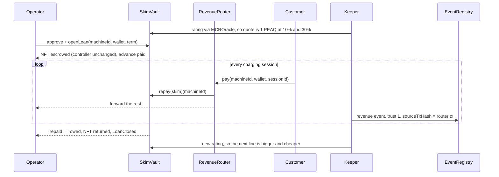
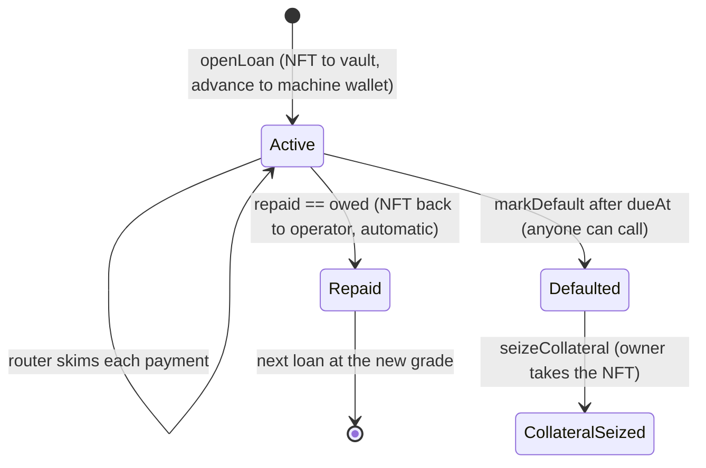
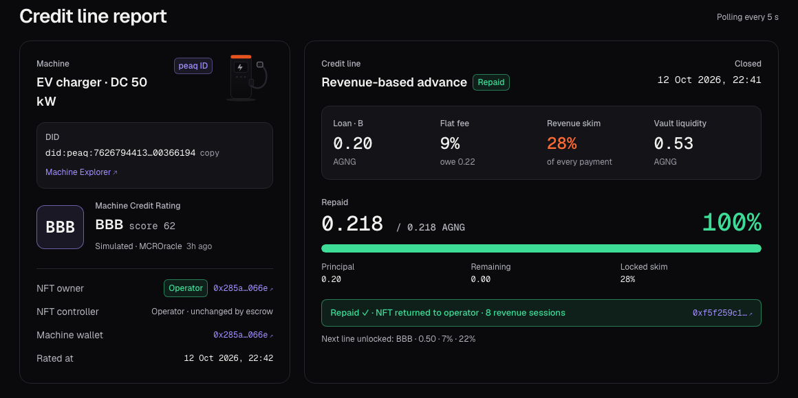

# SKIM

Revenue-based credit for machines on peaq.

An EV charger earns money every day, but nobody will lend against it. Banks don't underwrite a device, and DeFi lending wants over-collateralised tokens that a machine doesn't hold. What the machine does have is a stream of payments and an identity on chain. SKIM lends against both.

The operator puts the machine's Machine NFT into escrow and gets an advance. From then on, every customer payment goes through a router contract that sends a fixed share to the vault until the loan is paid off. When it is, the NFT goes back to the operator in the same transaction. Nobody sends invoices and nobody chases payments, because the contract takes its cut as the money arrives.

[Live app](https://skim-theta.vercel.app) · [Demo video, 2:16](https://drive.google.com/file/d/1bTtLVF0-TixY365fAAV-7SpBPHZrsy53/view) · [Every transaction of the on-chain run](docs/proof/agung.md)



## How a loan works

The machine has a Machine Credit Rating, which peaq computes from its revenue history. The rating decides the terms: how much it can borrow, the flat fee, and what share of each payment is skimmed. A brand new machine starts at Provisioned with a small line. Every payment it routes through SKIM is recorded as a revenue event that cites the router transaction, so the history that moves the rating is the same history the loan was repaid from.

The collateral is the Machine NFT. In peaq's Economics 2.0, transferring that NFT changes who owns the machine but leaves the DID controller where it was, so the operator keeps running, renewing and reporting on the machine while the vault holds the token. If a loan defaults, the vault is left with the NFT and the on-chain history attached to it.



One loan, step by step:



A loan moves through these states:



Repaying makes the next loan better. This is the terms table, scaled down by 10 on testnet:

| Grade | Principal (PEAQ) | Fee | Skim |
|---|---|---|---|
| Provisioned | 1 | 10% | 30% |
| B | 2 | 9% | 28% |
| BB | 3 | 8% | 25% |
| BBB | 5 | 7% | 22% |
| A | 8 | 6% | 20% |
| AA | 12 | 5% | 18% |
| AAA | 20 | 4% | 15% |

A worked example from the first agung loan: a Provisioned machine borrows 0.1 AGNG at a 10% flat fee, so it owes 0.11. A customer pays 0.05 AGNG per session. The router skims 30%, which is 0.015, to the vault and forwards 0.035 to the machine. After seven sessions the vault has taken 0.105, and the eighth skims only the last 0.005 owed, because the skim is capped at what is left. The loan closes and the NFT returns in that same transaction. The fee is the lender's income, so the vault ends with its seed plus 0.01.

A machine can't skip the router and keep the credit. Only revenue that passes through `RevenueRouter` becomes a trust-1 event, and only those events build the rating.

## It has run on peaq

On the agung testnet, a machine with a real activated machine ID borrowed 0.1 AGNG at a 10% fee, repaid it from eight routed payments, and got its NFT back. Its rating went up, so it borrowed again: 0.2 AGNG at 9%, paid this time by a separate customer wallet. That loan was repaid and the NFT returned too, and the machine ended up qualifying for 0.5 AGNG at 7%. The whole run is 54 transactions, all successful, each linked on subscan in [docs/proof/agung.md](docs/proof/agung.md).



| | Loan 1 | Loan 2 |
|---|---|---|
| Rating at origination | Provisioned | B |
| Principal | 0.1 AGNG | 0.2 AGNG |
| Fee and skim | 10% and 30% | 9% and 28% |
| Owed | 0.11 AGNG | 0.218 AGNG |
| Customer | same wallet as the operator | a separate wallet, `0x0c9A…E39d` |
| Payments | 8 sessions of 0.05 AGNG | 8 sessions of 0.1 AGNG |
| Transactions | 30, all succeeded | 24, all succeeded |
| Outcome | repaid, NFT returned, rating B | repaid, NFT returned, rating BBB, next line 0.5 AGNG at 7% and 22% |

The agung contracts:

| Contract | Address |
|---|---|
| SkimVault | [`0xA97b3C4F7cf5468dB2507C5769ad973e02F33D20`](https://agung-testnet.subscan.io/account/0xA97b3C4F7cf5468dB2507C5769ad973e02F33D20) |
| RevenueRouter | [`0xeD420FD5Ea0df60d2f873F13e34B4F5edbB99237`](https://agung-testnet.subscan.io/account/0xeD420FD5Ea0df60d2f873F13e34B4F5edbB99237) |
| MCROracle | [`0x90DD1c0C498243425dE0B93B6c7aa79bde15B793`](https://agung-testnet.subscan.io/account/0x90DD1c0C498243425dE0B93B6c7aa79bde15B793) |
| peaq MachineRegistry (the real one) | [`0x538da35489B1F0035799a8351E67835ae4ABb377`](https://agung-testnet.subscan.io/account/0x538da35489B1F0035799a8351E67835ae4ABb377) |

The key transactions of the run:

| Step | What happened | Transaction |
|---|---|---|
| Activation | the peaqOS SDK activates the machine, minting its NFT and `did:peaq:…` | [`0x7537…4ea8`](https://agung-testnet.subscan.io/tx/0x753718fee2bc5275e46138f094a34036e30897f501ffb433f905cb60e99c4ea8) |
| Loan 1 opened | the real Machine NFT moves into the vault, 0.1 AGNG is advanced | [`0x3e8b…09aa`](https://agung-testnet.subscan.io/tx/0x3e8bc2539edd50c3ed55b5d967a77e913df07f8cfc7c555454af67f8f82309aa) |
| Loan 1 repaid | the last payment closes the loan and returns the NFT | [`0xb8fa…2995`](https://agung-testnet.subscan.io/tx/0xb8fa6774b9388ae69a672739bc91c182fa68686da6dae011c5b3fc8a8b672995) |
| Loan 2 opened | the same machine, now rated B, borrows 0.2 AGNG | [`0x35cc…9692`](https://agung-testnet.subscan.io/tx/0x35ccdad22846286067b810c7ff8cdc30029f1c5a569142256032fd1c7bea9692) |
| Loan 2 repaid | the last payment closes the loan and returns the NFT | [`0xf5f2…be46`](https://agung-testnet.subscan.io/tx/0xf5f259c15a7ff6950c27475fc25cf66bc47a4a5793978b544eeec5cd77b1be46) |

The revenue events on agung carry 0 US cents, because a 0.1 AGNG session is worth under one cent and peaq's event format counts whole cents. The real amounts are in each event's metadata, and the event cites the router transaction, so it can still be checked. Read-back after loan 2: the NFT owner is the operator, `totalRepaid` is 0.328 AGNG, the rating is BBB with `simulated = true`, and there are 16 revenue events, each citing a distinct router transaction.

On a local fork of peaq mainnet, the vault escrowed a real mainnet Machine NFT and handed it back. While the NFT sat in escrow the operator was still able to file a trust-1 event to the live EventRegistry 2.0, which is the point of peaq's owner and controller split. The transcript is in [docs/proof/mainnet-fork-escrow.txt](docs/proof/mainnet-fork-escrow.txt).

The contracts have 42 Foundry tests, covering:

| Area | Tests |
|---|---|
| Skim math | fixed cases and fuzzing, with the skim capped at what is owed |
| Repayment | partial payments, excess refunds, auto-close and NFT return |
| Default | `markDefault` after the due date and `seizeCollateral` |
| Safety | reentrancy, access control, stray-NFT rejection, mock registry validation |
| Frozen terms | active loan terms can't be changed by the owner or the keeper |
| Routing | the router forwards everything when there is no loan |

The output is in [docs/proof/forge-test.txt](docs/proof/forge-test.txt), and there is a short [security review](docs/proof/security-review.md). The keeper only counts revenue events whose cited transaction really is a router payment, so a rating can't be pumped with fake events ([test](docs/proof/rating-integrity-test.txt)).

What is real and what is simulated, piece by piece:

| Piece | agung testnet | Mainnet fork |
|---|---|---|
| Machine NFT escrow | the real NFT of an activated machine | a real mainnet machine |
| Owner and controller split | `controllerOf` unchanged while the vault owns the NFT | same result |
| Revenue events (trust 1) | `MockEventRegistry`, flagged simulated | filed to the live EventRegistry 2.0 |
| Rating | derived from the events, flagged simulated | not exercised |
| Charger and customers | a script paying with real tokens | a script |

On mainnet the keeper reads the live MCR API and files events through the peaqOS SDK. The SDK call and the MCR API have both been exercised read-only: `previewMachineActivation` returns an Entry-tier bond of about 0.47 PEAQ, and the MCR API answers for a real mainnet machine ([transcript](docs/proof/sdk-preview.txt), [MCR response](docs/proof/mcr-api.txt)).

agung has no MCR and no EventRegistry 2.0, which is why those two are simulated there. The flags are set on chain (`Rating.simulated`) and shown in the app.

## Run it

You need Node 22 or newer and `curl`.

```bash
bash scripts/setup.sh                   # pinned Foundry, OpenZeppelin 5.1.0, forge-std; builds and runs the 42 tests
cd web && npm install && npm run dev    # http://localhost:3000
```

The app reads the agung deployment and shows the real loan. The card at the top of the page is a scripted replay of one full loan cycle, so you can watch the mechanism without waiting for chain data. Add `?demo` to the URL to skip the chain read entirely.

To run the whole loop yourself on a local chain, with no funds needed:

```bash
cd agent && npm install && npm run local:e2e    # contracts, keeper and charger simulator on anvil
cd ../web && npm install && npm run dev         # open http://localhost:3000/?network=local
```

`bash scripts/setup.sh --all` also runs the mainnet-fork escrow check and installs the agent and web dependencies.

<details>
<summary>agung testnet and peaq mainnet</summary>

For agung, copy `agent/.env.example` to `agent/.env`, set `NETWORK=agung` and a funded `PRIVATE_KEY`, then:

```bash
cd agent
NETWORK=agung ACTIVATE_MODE=sdk npm run activate   # real Economics 2.0 activation, 0.4 AGNG bond
NETWORK=agung npm run deploy
NETWORK=agung npm run demo
```

For mainnet, set `OPERATOR_PRIVATE_KEY`, `DEPLOYER_PRIVATE_KEY`, `KEEPER_PRIVATE_KEY`, `CUSTOMER_PRIVATE_KEY`, `MACHINE_SERIAL` and `PEAQ_USD`, then:

```bash
NETWORK=mainnet ACTIVATE_DRY_RUN=1 npm run activate   # previews the bond, sends nothing
NETWORK=mainnet npm run activate
NETWORK=mainnet TERMS_SCALE=150/1 SEED_LIQUIDITY=160 npm run deploy
NETWORK=mainnet npm run keeper &
NETWORK=mainnet npm run open-loan
NETWORK=mainnet SESSION_VALUE=240 SESSION_INTERVAL=30 STOP_WHEN_REPAID=1 npm run simulator
```

The MCR only counts revenue events worth at least $10, which is roughly 235 PEAQ per session at current prices. With `TERMS_SCALE=150/1` the starter line is 150 PEAQ and a 240 PEAQ session skims 72, so the loan is repaid in three sessions.

</details>

## What is in the repo

```
contracts/    Foundry project: SkimVault, RevenueRouter, MCROracle, mocks, 42 tests
agent/        deploy, activate, keeper, charger simulator and demo scripts; logs/ has the proof transcripts
web/          Next.js app, a static export that reads deployments/<network>.json
deployments/  addresses, machine ID and ABIs per network
docs/         proof/ (captured runs), submission/ (video script, form text), img/
scripts/      setup.sh, the pinned one-time setup
SPEC.md       the build spec; CHANGES.md lists where the build departs from it
```

The contracts, in `contracts/src`:

| Contract | What it does |
|---|---|
| `SkimVault` | Holds the liquidity and the grade-to-terms table. `quote` prices a loan from the rating. `openLoan` escrows the NFT and pays the advance. `repay` accepts payments from anyone, caps at what is owed and refunds the excess. It closes the loan and returns the NFT automatically. `markDefault` works after `dueAt`, and `seizeCollateral` after a default. |
| `RevenueRouter` | `pay(machineId, machineWallet, sessionId)` skims to the vault while a loan is active and always pays the loan's wallet. With no loan it forwards everything. It emits `RevenueRouted` and is reentrancy-guarded. |
| `MCROracle` | Stores the keeper-posted `Rating {score, grade, updatedAt, simulated}`, with grade 0 for Provisioned up to 6 for AAA. |
| `MockMachineNFT` | An open-mint ERC-721 standing in for MachineRegistry on local chains. |
| `MockEventRegistry` | An EventRegistry-shaped sink for networks without Economics 2.0 events. |

The agent, in `agent/` (Node 22, TypeScript, viem, `@peaqos/peaq-os-sdk` 0.11.2):

| Script | What it does |
|---|---|
| `scripts/deploy.ts` | Deploys everything, seeds liquidity and writes `deployments/<network>.json`. |
| `scripts/activate.ts` | With `ACTIVATE_MODE=sdk` it runs peaqOS `activateMachine` (Economics 2.0, Entry tier). With `mock` it mints on MockMachineNFT. |
| `src/keeper.ts` | One loop turns every `RevenueRouted` into a trust-1 revenue event that cites the router tx. A second loop reads the MCR API, or a simulated score, and posts it to the oracle. |
| `src/simulator.ts` | The EV charger: a customer pays `router.pay` every `SESSION_INTERVAL` seconds. |
| `src/demo.ts` | A one-shot scripted run of the whole loop. |
| `scripts/open-loan.ts`, `scripts/status.ts` | Operator helpers. |

The web app is one page: the loan replay, a short tour of the design, the revenue feed, the terms by grade, the credit line report, and a row of links to the real transactions.

peaq reports 3.3 million machine identities and over 200 million transactions on its network ([Introducing Economics 2.0](https://www.peaq.xyz/blog/introducing-peaq-economics-2-0-upgraded-to-set-machines-free)), and lists "rating-backed financing" as a Pro-tier peaqOS function. SKIM is a working version of that. More sourced context is in [docs/submission/IMPACT.md](docs/submission/IMPACT.md).
