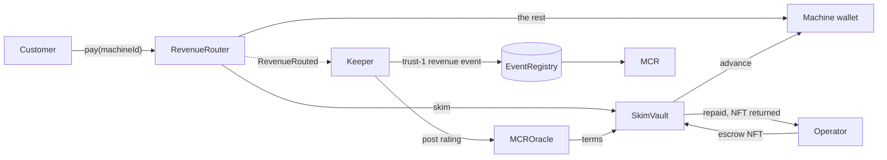

# SKIM

Revenue-based credit for machines on peaq.

An EV charger earns money every day, but nobody will lend against it. Banks don't underwrite a device, and DeFi lending wants over-collateralised tokens that a machine doesn't hold. What the machine does have is a stream of payments and an identity on chain. SKIM lends against both.

The operator puts the machine's Machine NFT into escrow and gets an advance. From then on, every customer payment goes through a router contract that sends a fixed share to the vault until the loan is paid off. When it is, the NFT goes back to the operator in the same transaction. Nobody sends invoices and nobody chases payments, because the contract takes its cut as the money arrives.

[Live app](https://skim-theta.vercel.app) · [Demo video, 2:16](https://drive.google.com/file/d/1bTtLVF0-TixY365fAAV-7SpBPHZrsy53/view) · [Every transaction of the on-chain run](docs/proof/agung.md)


## How a loan works

The machine has a Machine Credit Rating, which peaq computes from its revenue history. The rating decides the terms: how much it can borrow, the flat fee, and what share of each payment is skimmed. A brand new machine starts at Provisioned with a small line. Every payment it routes through SKIM is recorded as a revenue event that cites the router transaction, so the history that moves the rating is the same history the loan was repaid from.

The collateral is the Machine NFT. In peaq's Economics 2.0, transferring that NFT changes who owns the machine but leaves the DID controller where it was, so the operator keeps running, renewing and reporting on the machine while the vault holds the token. If a loan defaults, the vault is left with the NFT and the on-chain history attached to it.



Repaying makes the next loan better. This is the terms table, scaled down by 10 on testnet:

| Grade | Principal (PEAQ) | Fee | Skim |
|---|---|---|---|
| Provisioned | 1 | 10% | 30% |
| B | 2 | 9% | 28% |
| BB | 3 | 8% | 25% |
| BBB | 5 | 7% | 22% |
| A | 8 | 6% | 20% |
| AA | 12 | 5% | 18% |
| AAA | 20 | 4% | 15% |

A machine can't skip the router and keep the credit. Only revenue that passes through `RevenueRouter` becomes a trust-1 event, and only those events build the rating.

## It has run on peaq

On the agung testnet, a machine with a real activated machine ID borrowed 0.1 AGNG at a 10% fee, repaid it from eight routed payments, and got its NFT back. Its rating went up, so it borrowed again: 0.2 AGNG at 9%, paid this time by a separate customer wallet. That loan was repaid and the NFT returned too, and the machine ended up qualifying for 0.5 AGNG at 7%. The whole run is 54 transactions, all successful, each linked on subscan in [docs/proof/agung.md](docs/proof/agung.md).


On a local fork of peaq mainnet, the vault escrowed a real mainnet Machine NFT and handed it back. While the NFT sat in escrow the operator was still able to file a trust-1 event to the live EventRegistry 2.0, which is the point of peaq's owner and controller split. The transcript is in [docs/proof/mainnet-fork-escrow.txt](docs/proof/mainnet-fork-escrow.txt).

The contracts have 42 Foundry tests: skim math with fuzzing, auto-close, default and seizure, reentrancy, access control, and a check that active loan terms can't be changed by the owner or the keeper. The output is in [docs/proof/forge-test.txt](docs/proof/forge-test.txt), and there is a short [security review](docs/proof/security-review.md). The keeper only counts revenue events whose cited transaction really is a router payment, so a rating can't be pumped with fake events ([test](docs/proof/rating-integrity-test.txt)).

agung has no MCR and no EventRegistry 2.0, so on testnet the charger is a script that pays the router with real tokens, revenue events go to a mock registry, and the rating is derived from them. These are flagged as simulated on chain and in the app. On mainnet the keeper uses the live MCR API and the real registry.

## Run it

You need Node 22 or newer and `curl`.

```bash
bash scripts/setup.sh                   # pinned Foundry, OpenZeppelin 5.1.0, forge-std; builds and runs the 42 tests
cd web && npm install && npm run dev    # http://localhost:3000
```

The app reads the agung deployment and shows the real loan. The card at the top of the page is a scripted replay of one full loan cycle, so you can watch the mechanism without waiting for chain data. Add `?demo` to the URL to skip the chain read entirely.

To run the whole loop yourself on a local chain, with no funds needed:

```bash
cd agent && npm install && npm run local:e2e    # contracts, keeper and charger simulator on anvil
cd ../web && npm install && npm run dev         # open http://localhost:3000/?network=local
```

`bash scripts/setup.sh --all` also runs the mainnet-fork escrow check and installs the agent and web dependencies.

<details>
<summary>agung testnet and peaq mainnet</summary>

For agung, copy `agent/.env.example` to `agent/.env`, set `NETWORK=agung` and a funded `PRIVATE_KEY`, then:

```bash
cd agent
NETWORK=agung ACTIVATE_MODE=sdk npm run activate   # real Economics 2.0 activation, 0.4 AGNG bond
NETWORK=agung npm run deploy
NETWORK=agung npm run demo
```

For mainnet, set `OPERATOR_PRIVATE_KEY`, `DEPLOYER_PRIVATE_KEY`, `KEEPER_PRIVATE_KEY`, `CUSTOMER_PRIVATE_KEY`, `MACHINE_SERIAL` and `PEAQ_USD`, then:

```bash
NETWORK=mainnet ACTIVATE_DRY_RUN=1 npm run activate   # previews the bond, sends nothing
NETWORK=mainnet npm run activate
NETWORK=mainnet TERMS_SCALE=150/1 SEED_LIQUIDITY=160 npm run deploy
NETWORK=mainnet npm run keeper &
NETWORK=mainnet npm run open-loan
NETWORK=mainnet SESSION_VALUE=240 SESSION_INTERVAL=30 STOP_WHEN_REPAID=1 npm run simulator
```

The MCR only counts revenue events worth at least $10, which is roughly 235 PEAQ per session at current prices. With `TERMS_SCALE=150/1` the starter line is 150 PEAQ and a 240 PEAQ session skims 72, so the loan is repaid in three sessions.

</details>

## What is in the repo

```
contracts/    Foundry project: SkimVault, RevenueRouter, MCROracle, mocks, 42 tests
agent/        deploy, activate, keeper, charger simulator and demo scripts; logs/ has the proof transcripts
web/          Next.js app, a static export that reads deployments/<network>.json
deployments/  addresses, machine ID and ABIs per network
docs/         proof/ (captured runs), submission/ (video script, form text), img/
scripts/      setup.sh, the pinned one-time setup
SPEC.md       the build spec; CHANGES.md lists where the build departs from it
```

`SkimVault` holds the liquidity, the grade-to-terms table, the escrow and the loan state. `RevenueRouter` splits each payment and forwards everything when there is no active loan. `MCROracle` stores the rating the keeper posts. The keeper in `agent/src/keeper.ts` watches `RevenueRouted`, writes the revenue event, and keeps the oracle's rating in line with the MCR API. The web app is one page: the loan replay, a short tour of the design, the revenue feed, the terms by grade, the credit line report, and a row of links to the real transactions.

peaq reports 3.3 million machine identities and over 200 million transactions on its network ([Introducing Economics 2.0](https://www.peaq.xyz/blog/introducing-peaq-economics-2-0-upgraded-to-set-machines-free)), and lists "rating-backed financing" as a Pro-tier peaqOS function. SKIM is a working version of that. More sourced context is in [docs/submission/IMPACT.md](docs/submission/IMPACT.md).
